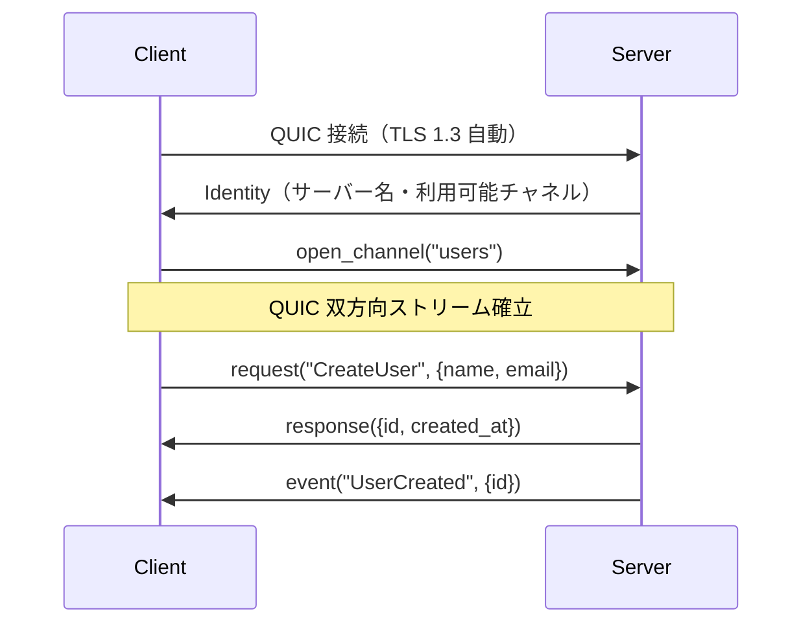

[English](https://github.com/chronista-club/club-unison/blob/main/README.md) | 日本語

# Unison Protocol

KDL スキーマベースの型安全な QUIC 通信フレームワーク。

[](https://crates.io/crates/club-unison)
[](https://github.com/chronista-club/club-unison/actions/workflows/ci.yml)
[](https://github.com/chronista-club/club-unison/blob/main/LICENSE)

```toml
[dependencies]
# crates.io package = `club-unison`、Rust crate identifier = `unison`
club-unison = "2.4.0"
tokio = { version = "1.52", features = ["full"] }
```

```rust
use unison::network::{CertSource, TrustAnchors};
use unison::network::quic::{QuicClient, QuicServer};

// Server: TLS cert を CertSource enum で明示選択
let server_config = QuicServer::configure_server_with(CertSource::dev_localhost()).await?;

// Client: trust anchor も TrustAnchors enum で明示選択
let client_config = QuicClient::configure_client_with(TrustAnchors::System).await?;

// 内部メッシュ (固定ペア): 両端を 1 つの pair で生成
use unison::network::InternalMeshKeypair;
let pair = InternalMeshKeypair::generate(["broker.local".into(), "*.unison.local".into()])?;
// pair.server_cert_source → server 側 / pair.client_trust_anchors → client 側

// 内部メッシュ (多 server): private CA で per-server cert を発行
use unison::network::MeshCa;
let ca = MeshCa::generate()?;
let server_cert = ca.issue(["cp.internal".into()])?; // server 側 CertSource
let client_trust = ca.trust_anchors();               // 全 client 共通 (CA 1 枚を信頼)
```

詳細な trust model 設計は [CHANGELOG](https://github.com/chronista-club/club-unison/blob/main/CHANGELOG.md) の v0.7.0 (TLS 導入) / v0.9.0 (deprecated `configure_*()` 削除) / v1.0.0-rc.3 (`MeshCa` private CA) entry を参照。

---

## 接続すると何が起こるか

クライアントがサーバーに接続し、チャネルを開いてやり取りするまでの流れ。



1. クライアントが QUIC で接続する。TLS 1.3 証明書は開発時は自動生成される
2. サーバーが Identity を返す（サーバー名、バージョン、利用可能なチャネル一覧）
3. クライアントがチャネルを開くと QUIC 双方向ストリームが確立される
4. 以降、そのチャネル上で Request/Response、Event push、Raw bytes を自由にやり取りする

全通信がチャネル経由。RPC という概念はなく、`UnisonChannel` に統一されている。

---

## サーバーを書く

```rust
use std::sync::Arc;
use unison::ProtocolServer;
use unison::network::UnisonChannel;
use serde_json::json;

#[tokio::main]
async fn main() -> Result<(), Box<dyn std::error::Error>> {
    let server = ProtocolServer::with_identity(
        "my-server", "1.0.0", "com.example.myservice",
    );

    // チャネルハンドラーの登録
    server.register_channel("users", |_ctx, stream| async move {
        let channel = UnisonChannel::new(stream);
        loop {
            match channel.recv().await {
                Ok(msg) => {
                    channel.send_response(msg.id, &msg.method, &json!({"id": "1"})).await?;
                }
                Err(_) => break,
            }
        }
        Ok(())
    }).await;

    // バックグラウンドで起動（グレースフルシャットダウン対応）
    let handle = Arc::new(server).listener("[::1]:8080").spawn().await?;
    println!("サーバー起動: {}", handle.local_addr());

    // Ctrl-C まで待ってからグレースフルに停止
    tokio::signal::ctrl_c().await?;
    handle.shutdown().await?;
    Ok(())
}
```

## クライアントを書く

```rust
use unison::ProtocolClient;
use serde_json::json;

#[tokio::main]
async fn main() -> Result<(), Box<dyn std::error::Error>> {
    // dev 用: サーバー証明書を検証しない（接続先は loopback に限る）
    let client = ProtocolClient::insecure_localhost()?;
    client.connect("[::1]:8080").await?;

    // チャネルを開いて Request/Response
    let users = client.open_channel("users").await?;
    let response: serde_json::Value = users.request("CreateUser", &json!({
        "name": "Alice",
        "email": "alice@example.com"
    })).await?;
    println!("作成されたユーザー: {}", response);

    users.close().await?;

    Ok(())
}
```

---

## UnisonChannel

1つのチャネルで3種類の通信パターンをサポートする。

```
Client                              Server
  |                                    |
  |-- open_channel("users") ---------> |  (QUIC bidi stream)
  |                                    |
  |<-- UnisonChannel ----------------->|  UnisonChannel
  |    .request()    -> Protocol frame  |    .recv()
  |    .send_event() -> Protocol frame  |    .send_response()
  |    .send_raw()   -> Raw frame      |    .send_raw()
  |    .recv()       <- Protocol frame  |    .recv_raw()
  |    .recv_raw()   <- Raw frame      |
```

```rust
// Request/Response
let res: serde_json::Value = channel.request("CreateUser", &payload).await?;
channel.send_response(id, method, &payload).await?;

// Event push（一方向）
channel.send_event("UserCreated", &payload).await?;

// Raw bytes（buffa/zstd をバイパス、オーディオ等に）
channel.send_raw(&pcm_data).await?;
let data = channel.recv_raw().await?;
```

フレームの先頭 1 バイトで Protocol frame (`0x00`, buffa + zstd) と Raw frame (`0x01`, 生バイト) を区別する。2KB 以上のペイロードは自動で zstd 圧縮される。

---

## 接続イベント

```rust
use unison::ConnectionEvent;

let mut events = server.subscribe_connection_events();
tokio::spawn(async move {
    while let Ok(event) = events.recv().await {
        match event {
            ConnectionEvent::Connected { remote_addr, .. } => {
                println!("接続: {}", remote_addr);
            }
            ConnectionEvent::Disconnected { remote_addr, .. } => {
                println!("切断: {}", remote_addr);
            }
        }
    }
});
```

## KDL スキーマ

プロトコルを KDL で定義すると、Rust / TypeScript のコードを自動生成できる。

```kdl
protocol "my-service" version="1.0.0" {
    namespace "com.example.myservice"

    channel "users" from="client" lifetime="persistent" {
        request "CreateUser" {
            field "name" type="string" required=#true
            field "email" type="string" required=#true

            returns "UserCreated" {
                field "id" type="string" required=#true
                field "created_at" type="timestamp" required=#true
            }
        }
    }
}
```

---

## State Sync (`unison::sync`)

Origin（正本）と Slave（複製）の間でインメモリのオブジェクトストアを QUIC 越しに自動同期する。多段 `Relay`（`Origin → Relay(Slave+Origin) → Slave`）にも対応。

- **2 チャネル QUIC トランスポート**:
  - `unison.sync`（client → server）: `Join` ハンドシェイク（初期 `SyncSnapshot` 応答）と Slave の `PushBatch`（`SyncBatch`）。
  - `unison.sync.feed`（server → client、server-initiated stream）: `Origin` の更新（`SyncFrame`）を参加済み全 Slave へリアルタイム配信。
- **Protobuf (buffa) wire + ゼロアロケーション読み取り**: ペイロードは `bytes::Bytes`、wire 表現は [`buffa`](https://crates.io/crates/buffa)（`proto/sync.proto`）に統一。`buffa::MessageView<'a>`（`with_slot` / `get_owned_view` / `decode_view`）により **ヒープ割り当てゼロ（0 alloc）** でスロットのデータを直接参照できる。
- **収束性と整合性保証**（Quint で形式検証済み）: 単調増加 `version`・`origin_seq` 順序保証・べき等 `apply`・未送信ローカル変更の `dirty` 保護・定期 `Flush` / `KeepAlive` 自動実行。

```rust
use std::sync::Arc;
use bytes::Bytes;
use unison::{ProtocolClient, ProtocolServer};
use unison::sync::{ConnectedSlave, Origin, Relay, Slave, SyncConfig, SyncServer, decode_view};
use unison::sync::proto::SyncObjectView;

// 1. ProtocolServer に SyncServer (Origin) をアタッチ
let origin = Arc::new(Origin::new());
origin.insert(1, Bytes::from_static(b"initial-state"), 100);
let sync_server = Arc::new(SyncServer::new(origin.clone(), SyncConfig::default()));

let server = Arc::new(ProtocolServer::with_identity("sync-node", "2.4.0", "club.chronista.sync"));
sync_server.attach(&server).await;

// 2. Slave を QUIC 接続 — 初期 Snapshot 適用と Flush / KeepAlive / Feed 受信タスクが自動起動
let client = Arc::new(ProtocolClient::insecure_localhost()?);
client.connect("[::1]:8080").await?;
let connected = ConnectedSlave::connect(client, Arc::new(Slave::new()), SyncConfig::default()).await?;

// 3. スロットのゼロアロケーション参照 (buffa::MessageView<'a>)
let state: Option<Bytes> = connected.slave().with_slot(1, |obj| obj.state.clone());

// または protobuf エンコード済みバッファから直接ゼロコピーの MessageView<'a> を借用:
// let view: SyncObjectView<'_> = decode_view(&buf)?;
```

仕様と内部設計の詳細は [spec/05-sync/SPEC.md](https://github.com/chronista-club/club-unison/blob/main/spec/05-sync/SPEC.md) と [design/sync.md](https://github.com/chronista-club/club-unison/blob/main/design/sync.md) を参照。

---

## ワークスペースクレート

| クレート | 説明 |
|---------|------|
| [`unison-protocol`](https://github.com/chronista-club/club-unison/tree/main/crates/unison-protocol) | コアライブラリ。crates.io では `club-unison` として公開、Rust crate identifier は `unison`。KDL スキーマ、QUIC、チャネル、パケット、`unison::sync` |
| [`unison-mcp`](https://github.com/chronista-club/club-unison/tree/main/crates/unison-mcp) | MCP bridge（`unison-mcp` バイナリ）。サーバーの KDL を実行時に discovery し、`request` ごとに MCP tool を合成して AI agent から呼べるようにする |
| [`unison-cli`](https://github.com/chronista-club/club-unison/tree/main/crates/unison-cli) | 開発者向け CLI（`unison` バイナリ）: `ping` / `call` / `sniff` / `mock`（KDL から stub server）/ `schema-lint` / `schema-diff` / `schema-check` |

## 多言語クライアント (Polyglot clients)

サーバーは Rust に集約し、各言語のクライアントを [`clients/`](https://github.com/chronista-club/club-unison/tree/main/clients) 配下でファーストクラスに提供する。wire format の適合性とプロトコル意味論をこのフレームワーク側で持つため、どのクライアントも Rust サーバーとバイト単位で相互運用できる。

| クライアント | トランスポート | 配布形態 |
|------------|--------------|---------|
| [`clients/typescript`](https://github.com/chronista-club/club-unison/tree/main/clients/typescript) | WebTransport (HTTP/3) | npm `@chronista-club/unison-client` |
| [`clients/ruby`](https://github.com/chronista-club/club-unison/tree/main/clients/ruby) | raw QUIC (FFI → Rust) | RubyGems `unison-client` |
| [`clients/swift`](https://github.com/chronista-club/club-unison/tree/main/clients/swift) | raw QUIC (Apple `NWProtocolQUIC`, ALPN `"unison"`) | SPM（repo root の `Package.swift`）— 下記注記 |

> **Swift パッケージの利用**: `Package.swift` は **repo root** にあり（SPM の
> version 指定 remote 依存 `.package(url:from:)` は root manifest を要求するため）、
> source 実体は `clients/swift/` 配下で、root manifest が `path:` で参照する
> （= monorepo にコード集約しつつ SPM 配布も成立）。版数は monorepo の git tag
> （`vX.Y.Z` = Rust workspace 版）に連動する（Swift client は独立 versioning しない）。
>
> ```swift
> .package(url: "https://github.com/chronista-club/club-unison.git", from: "2.4.0")
> // target: .product(name: "UnisonClient", package: "club-unison")
> ```
>
> monorepo 隣接の開発なら path 依存も可: `.package(path: "../club-unison")`。

---

## 開発

```bash
git clone https://github.com/chronista-club/club-unison
cd club-unison
cargo build

# テスト (lib unit + integration tests)
RUSTFLAGS="-C symbol-mangling-version=v0" cargo test --workspace
```

**IPv4 / IPv6 どちらでも繋がる。** `[::1]:port`（IPv6 ループバック）でも `127.0.0.1:port`（IPv4 ループバック）でも、ホスト名（DNS 解決）でも OK。client は target アドレスの family に合わせて local bind を切り替える。CLI 既定と多くの例は IPv6 寄りで、bare port のみ（`8080` 等）指定した場合は `[::1]` にフォールバックする。

## ドキュメント

- [コアコンセプト](https://github.com/chronista-club/club-unison/blob/main/spec/01-core-concept/SPEC.md) — Everything is a Channel
- [Unified Channel Protocol](https://github.com/chronista-club/club-unison/blob/main/spec/02-unified-channel/SPEC.md) — KDL スキーマ、チャネルルーティング、コード生成
- [Discovery](https://github.com/chronista-club/club-unison/blob/main/spec/04-discovery/SPEC.md) — KDL スキーマの実行時配布（`unison.discovery`）
- [State Sync 仕様](https://github.com/chronista-club/club-unison/blob/main/spec/05-sync/SPEC.md) / [State Sync 設計](https://github.com/chronista-club/club-unison/blob/main/design/sync.md) — `unison::sync` Origin ↔ Slave 自動同期・`buffa::MessageView` ゼロアロケーション読み取り
- [チャネルガイド](https://github.com/chronista-club/club-unison/blob/main/guides/channel-guide.md) — 実践ガイド
- [仕様書一覧](https://github.com/chronista-club/club-unison/tree/main/spec) / [設計ドキュメント一覧](https://github.com/chronista-club/club-unison/tree/main/design) / [実装ガイド一覧](https://github.com/chronista-club/club-unison/tree/main/guides)

## ライセンス

MIT License - [LICENSE](https://github.com/chronista-club/club-unison/blob/main/LICENSE)

---

> **Inspired by**: 宝鐘マリン船長の [Unison](https://www.youtube.com/watch?v=_VIeV_LZXHM) ⚓
> 「同じ調べに乗る」という意味も、このフレームワークの名に込めています。
