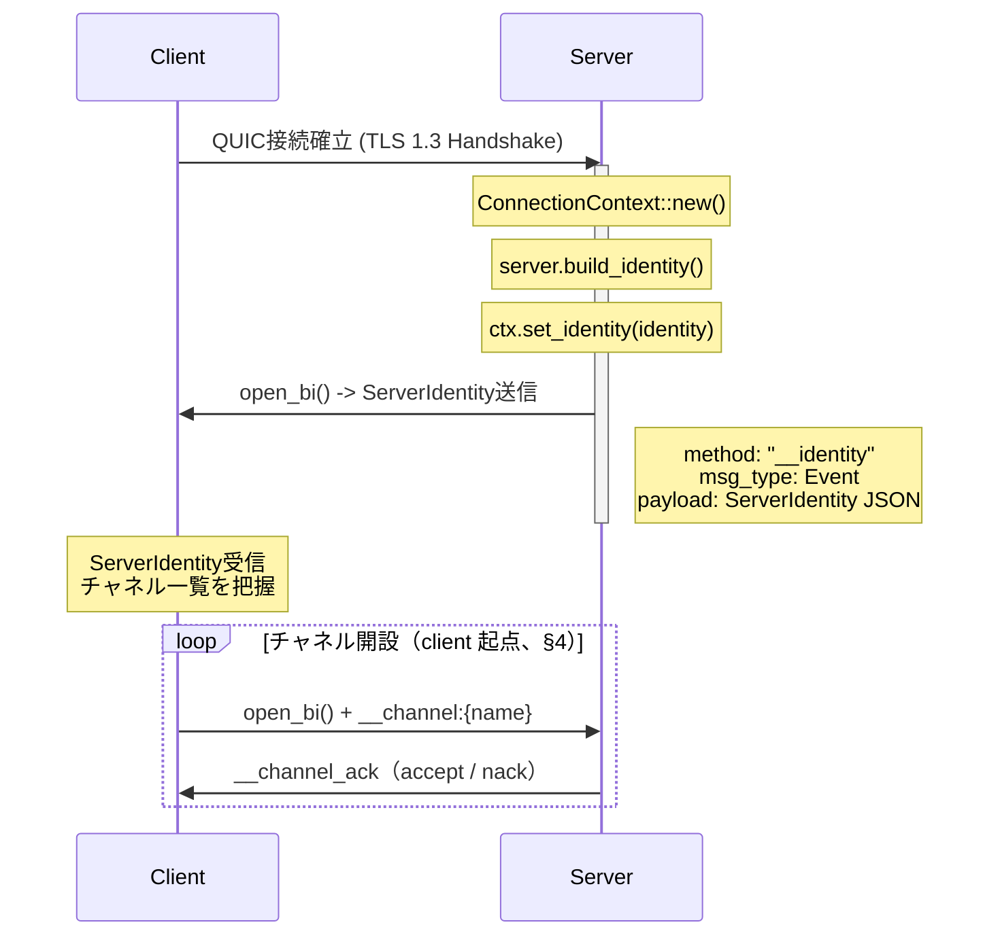
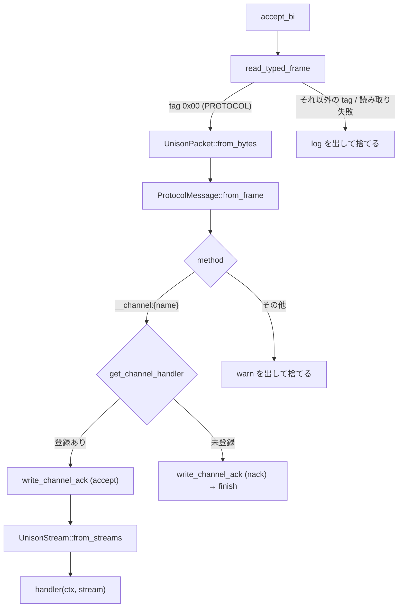

# QUIC Runtime 統合

## 1. 概要

本ドキュメントでは、Unison ProtocolにおけるQUIC Runtime統合の設計を記述する。QUICトランスポート層は以下の要素で構成される:

- **ALPN**: raw QUIC は ALPN `"unison"` を negotiate（`network::UNISON_ALPN`）
- **ConnectionContext**: 接続ごとの状態管理（identity、チャネル追跡、認証済み principal、server 起点 stream 用の connection）
- **Identity Handshake**: 接続直後のサーバー自己紹介プロトコル
- **チャネルルーティング**: `__channel:` プレフィックスによるチャネル多重化
- **Typed Framing**: `[u32 BE len][u8 type tag][payload]` によるフレーム境界
- **UnisonChannel**: 統合チャネル型（request/response + event push + raw bytes）

### ALPN（v1.3.0+）

QUIC は仕様（RFC 9001 §8.1）で ALPN を必須とする。raw QUIC の server
（`quic.rs`）と client（`trust.rs`）は SSOT である `network::UNISON_ALPN`
（= `"unison"`）を negotiate する。空 ALPN は仕様逸脱であり、Apple
`NWProtocolQUIC` 等の厳格実装（Swift client）と interop できないため v1.3.0 で
明示設定した。

> ⚠️ **互換性（重要）**: ALPN を設定した server は、ALPN を送らない**旧 client を
> `no_application_protocol` で拒否する**。QUIC は ALPN 必須なので、rustls/quinn は
> plain TLS（client が ALPN を出さなければ enforce しない）と違い handshake 時に
> **enforce する**（empty-ALPN client での実測で確認済み）。したがって v1.3.0 は
> raw QUIC client にとって **breaking** で、**後方互換ではない**:
> - **Rust client / Swift client**: `"unison"` を送るため OK。
> - **Ruby client（FFI）**: gem が pin する `club-unison` を **1.3.0+ に上げて
>   ビルドし直す必要がある**（旧 lock の 1.0.x は empty ALPN → 拒否される）。
> - **WebTransport（TS）**: HTTP/3 の `"h3"` 別 ingress なので**無影響**。
>
> WebTransport 経路は HTTP/3 上のため ALPN は `"h3"` 固定（`wtransport` 依存が内部
> 設定）で、本 const は適用されない（別 ingress）。回帰テスト:
> `crates/unison-protocol/tests/test_medium_alpn_enforcement.rs`。

全体のアーキテクチャ層における位置付け:

```
Application Layer
    |
Service Layer   --- UnisonChannel (統合チャネル: request/response + event + raw)
    |
Protocol Layer  --- ProtocolMessage / UnisonPacket
    |
Transport Layer --- UnisonStream / read_typed_frame / write_typed_frame
    |
Network Layer   --- UnisonConn (quinn / wtransport、QUIC/TLS 1.3)
```

## 2. ConnectionContext

**ファイル**: `crates/unison-protocol/src/network/context.rs`

ConnectionContextは、QUIC接続ごとの状態を管理する構造体である。各接続に対して一意のUUID、Identity情報、アクティブチャネルの追跡、認証済み principal、server 起点 stream 用の connection を提供する。

### 構造体定義

```rust
pub struct ConnectionContext {
    /// 接続の一意識別子
    pub connection_id: Uuid,
    /// サーバーから受信したIdentity情報
    identity: Arc<RwLock<Option<ServerIdentity>>>,
    /// アクティブなチャネルのマップ（チャネル名 -> ハンドル）
    channels: Arc<RwLock<HashMap<String, ChannelHandle>>>,
    /// 認証済み client principal（未認証なら None、design/connection-auth.md）
    principal: Arc<RwLock<Option<Principal>>>,
    /// server 起点で stream を開くための connection（server 側のみ set、design/server-initiated-stream.md）
    conn: Arc<RwLock<Option<Arc<dyn UnisonConn>>>>,
}

pub struct ChannelHandle {
    pub channel_name: String,
    pub stream_id: u64,
    pub direction: ChannelDirection,
}

// network/identity.rs
pub enum ChannelDirection {
    ServerToClient,
    ClientToServer,
    Bidirectional,
}
```

### ライフサイクル

```mermaid
stateDiagram-v2
    [*] --> Created: ConnectionContext::new()
    Created --> IdentityReceived: set_identity()
    IdentityReceived --> Active: register_channel()
    Active --> Active: register_channel() / remove_channel()
    Active --> Closing: 接続クローズ
    IdentityReceived --> Closing: 接続クローズ
    Closing --> [*]
```

### 設計判断

- **Arc\<RwLock\<\>\> による並行保護**: 1つのQUIC接続に対して複数のストリームハンドラが並行動作するため、identity と channels を個別にロック管理する。これにより、チャネル登録がidentity参照をブロックしない。
- **UUID による接続識別**: `Uuid::new_v4()` で生成される128ビットの一意識別子。接続ログやデバッグ時のトレーサビリティに使用する。
- **principal / conn は後から足した field**: principal は `unison.auth` handler が `set_principal` で立てる（1.4.0、[connection-auth.md](./connection-auth.md)）。conn は `handle_connection` が server 側でだけ `set_conn` で立て、`open_server_stream` が使う（1.5.0、[server-initiated-stream.md](./server-initiated-stream.md)）。client 側の ctx では None のまま。

## 3. Identity Handshake

**ファイル**: `crates/unison-protocol/src/network/identity.rs`

QUICサーバーは接続を受け入れた直後に、サーバー自身の情報をクライアントに通知する。これにより、クライアントは接続先の能力（提供チャネル一覧、バージョン）を動的に把握できる。

### ServerIdentity 構造体

```rust
pub struct ServerIdentity {
    pub name: String,           // サーバー名（例: "unison"）
    pub version: String,        // バージョン（例: "0.1.0"）
    pub namespace: String,      // ネームスペース（例: "default"）
    pub channels: Vec<ChannelInfo>, // 利用可能なチャネル一覧
    pub metadata: serde_json::Value, // 拡張メタデータ
}

pub struct ChannelInfo {
    pub name: String,
    pub direction: ChannelDirection,  // ServerToClient / ClientToServer / Bidirectional
    pub lifetime: String,             // "persistent" / "transient"
    pub status: ChannelStatus,        // Available / Busy / Unavailable
}
```

### シーケンス図



client 側の受け取り（`client_accept_bi_loop` → oneshot → `ProtocolClient::connect`）は
[architecture.md](./architecture.md) §4.2 を参照。

### build_identity の動作

`ProtocolServer::build_identity()` は、登録済みのチャネルハンドラから動的に `ServerIdentity` を構築する:

```rust
pub async fn build_identity(&self) -> ServerIdentity {
    let mut identity = ServerIdentity::new(
        &self.server_name,
        &self.server_version,
        &self.server_namespace,
    );
    let handlers = self.channel_handlers.read().await;
    for channel_name in handlers.keys() {
        identity.add_channel(ChannelInfo {
            name: channel_name.clone(),
            direction: ChannelDirection::Bidirectional,
            lifetime: "persistent".to_string(),
            status: ChannelStatus::Available,
        });
    }
    identity
}
```

direction は常に `Bidirectional` で、KDL の `from="server"` はまだ反映しない
（[server-initiated-stream.md](./server-initiated-stream.md) §10 の 4）。

## 4. 接続ディスパッチとチャネルルーティング

**ファイル**: `crates/unison-protocol/src/network/dispatch.rs`

raw QUIC（`QuicServer`）と WebTransport（`WebTransportServer`）の両 ingress は、接続を
`Arc<dyn UnisonConn>` に包んで `handle_connection` に渡す。ここから先は transport の種類を
知らない。

### handle_connection の流れ

1. `ctx.set_conn` — server 起点 stream 用に connection を ctx に渡す（[server-initiated-stream.md](./server-initiated-stream.md)）
2. active connection 台帳に登録（= `ProtocolServer::broadcast` の配信先）
3. `start_datagram_handlers` — 登録済み datagram channel の handler を起動（[datagram-channel.md](./datagram-channel.md)）
4. `send_identity` — server 発の stream で `__identity` を 1 本送って finish（§3）
5. `ConnectionEvent::Connected` を発火
6. `accept_stream_loop` — client が開いた stream を 1 本ずつ `handle_incoming_stream` に渡し、1 stream = 1 task で spawn する。`accept_bi` が Err を返したら接続終了とみなし、`ConnectionEvent::Disconnected` を発火して抜ける
7. 後始末 — 台帳から外し、datagram handler の task を abort する

### ルーティング規則

先頭 frame の `ProtocolMessage.method` で振り分ける。どちらの側が受けるかで規則が違う。

| 受ける側 | 先頭 frame の method | 処理 |
|---|---|---|
| server（`handle_incoming_stream`） | `__channel:{name}` | 登録済みなら `__channel_ack`（Response）を返して handler へ `UnisonStream` を渡す。未登録なら nack（Error、`channel-not-found`）を返して finish |
| server（`handle_incoming_stream`） | それ以外 | warn を出して捨てる（channel 以外の message はサポート外） |
| client（`client_accept_bi_loop`） | `__identity` | identity 専用の oneshot へ（`ProtocolClient::connect` が受け取る） |
| client（`client_accept_bi_loop`） | それ以外（= `from="server"` の channel 名） | `register_server_channel` の registry を引いて handler へ `UnisonStream` を渡す。未登録なら warn を出して捨てる |

`client_accept_bi_loop` は `QuicClient` が接続ごとに spawn する。`quinn::Connection` を直に
受けるので、WebTransport client はこの経路を持たない。

### server 側のフロー



client から見た open / ack の往復は [architecture.md](./architecture.md) §4.1 のシーケンス図を参照。
handler は渡された `UnisonStream` を `UnisonChannel::new` で包んで使うか（built-in の
`unison.auth` / `unison.discovery` はこちら）、直に読む。

## 5. Typed Framing

**ファイル**: `crates/unison-protocol/src/network/frame.rs`

QUIC stream 上のメッセージ境界は typed frame で区切る。`read_typed_frame` /
`write_typed_frame` は `AsyncRead` / `AsyncWrite` に対して generic なので、quinn と
WebTransport のどちらの stream にも同じ関数を使う。

```rust
pub async fn read_typed_frame<R: AsyncRead + Unpin + ?Sized>(recv: &mut R) -> anyhow::Result<(u8, Bytes)>;
pub async fn write_typed_frame<W: AsyncWrite + Unpin + ?Sized>(send: &mut W, frame_type: u8, data: &[u8]) -> anyhow::Result<()>;
```

### フレームフォーマット

```
+-------------------+------------------+-------------------+
| Length (4 bytes)  | Type tag (1 byte)| Payload (N bytes) |
| Big-Endian u32    |                  |                   |
+-------------------+------------------+-------------------+
Length = 1 + N (= type tag と payload の合計)
```

| type tag | 定数 | payload |
|---|---|---|
| `0x00` | `FRAME_TYPE_PROTOCOL` | `UnisonPacket` のバイト列（中身は buffa で encode した `ProtocolMessage`、[packet.md](./packet.md)） |
| `0x01` | `FRAME_TYPE_RAW` | raw bytes。packet を通らない（`UnisonChannel::send_raw` / `recv_raw`） |

- **最大サイズ**: `MAX_MESSAGE_SIZE = 8 * 1024 * 1024`（8MB、type tag + payload）。読み書きの両側で検査する。read は Length が 0 または上限超なら Err、write は上限超なら何も書かずに Err（= `as u32` の切り詰めで Length と実データがずれるのを防ぐ）
- 未知の type tag は `UnisonStream::recv_typed_frame` が `NetworkError::Protocol` にする
- framing を喋らない peer 向けの `read_to_end` フォールバックは持たない。先頭 frame が読めなければその stream は捨てる

### 送信と受信の経路

- **送信**: `ProtocolMessage::into_frame` → `UnisonPacket::to_bytes` → `write_typed_frame(FRAME_TYPE_PROTOCOL, …)`（= `UnisonStream::send_frame`）
- **受信**: `read_typed_frame` → `UnisonPacket::from_bytes` → `ProtocolMessage::from_frame`（= `UnisonStream::recv_typed_frame`）

他言語 client との byte 一致は golden fixture で検証している（[packet.md](./packet.md) §6）。

## 6. UnisonStream と UnisonChannel

**ファイル**: `crates/unison-protocol/src/network/stream.rs` / `crates/unison-protocol/src/network/channel.rs`

### UnisonStream（handler に渡る面）

`UnisonStream` は transport 非依存の双方向 stream。send / recv を trait object
（`BoxUnisonSend` / `BoxUnisonRecv`）で持つので、raw QUIC と WebTransport で同じ型になる。

| メソッド | 動作 |
|---|---|
| `from_streams(stream_id, method, send, recv)` | 受け付けた / 開いた stream から作る |
| `send_frame(&msg)` | `ProtocolMessage` を tag 0x00 の frame で送る |
| `send_raw_frame(data)` | raw bytes を tag 0x01 の frame で送る |
| `recv_typed_frame()` | 1 frame 読み、`TypedFrame::{Protocol, Raw}` で返す |
| `recv_frame()` | `ProtocolMessage` だけを受ける（raw frame が来たら Err） |
| `close_stream()` | send 側を finish、recv 側を stop |
| `is_active()` | 読み取り失敗や close の後は false |

### UnisonChannel\<C\>（統合チャネル型）

`UnisonChannel::new(stream)` は `UnisonStream` を包み、recv ループを 1 本 spawn する。
codec `C`（既定 `JsonCodec`）で payload を encode / decode する。

| メソッド | 動作 |
|---|---|
| `request::<Req, Resp>(method, &req)` | id を振って pending に登録し、Response か Error を待つ。既定 30 秒で `NetworkError::Timeout`（`with_request_timeout` で変更） |
| `send_event(method, &payload)` | Event を一方向に送る |
| `send_response(request_id, method, &payload)` | 受けた Request に Response を返す（server 側） |
| `recv()` | Event（と Request など Response 以外）を受ける |
| `send_raw(data)` / `recv_raw()` | raw frame の送受信 |
| `close()` | recv ループを止め、stream を閉じる |

recv ループの振り分け:

- **Response** → id が一致する pending の oneshot へ
- **Error** → id が一致する pending があればそこへ、無ければ event 側へ
- **Event / Request / その他** → event 側の mpsc（buffer 256）へ
- **Raw frame** → raw 側の mpsc（buffer 256）へ
- **読み取り失敗**（接続断など） → 全 pending を Error で解決してループを抜ける

event / raw の配送は `try_send` で、buffer が full なら drop して warn を出す。遅い consumer が
recv ループを止めると、後ろに並んだ Response まで届かなくなるため（= HoL stall の回避）。
取りこぼせない server→client 配送は、この mpsc を通らない server 起点 stream
（[server-initiated-stream.md](./server-initiated-stream.md)）を使う。

channel が正常に終わったときは `recv` / `recv_raw` / `request` が `NetworkError::ChannelEof`
を返す（`is_normal_close()` が true、[architecture.md](./architecture.md) §5）。

## 関連ドキュメント

- [アーキテクチャ](./architecture.md) -- システム全体のレイヤー構成
- [パケット設計](./packet.md) -- UnisonPacket のバイナリフォーマット
- [サーバー起点 stream](./server-initiated-stream.md) -- `open_server_stream` / `register_server_channel`
- [spec/02: Unified Channel](../spec/02-unified-channel/SPEC.md) -- KDLスキーマとメッセージ種別
